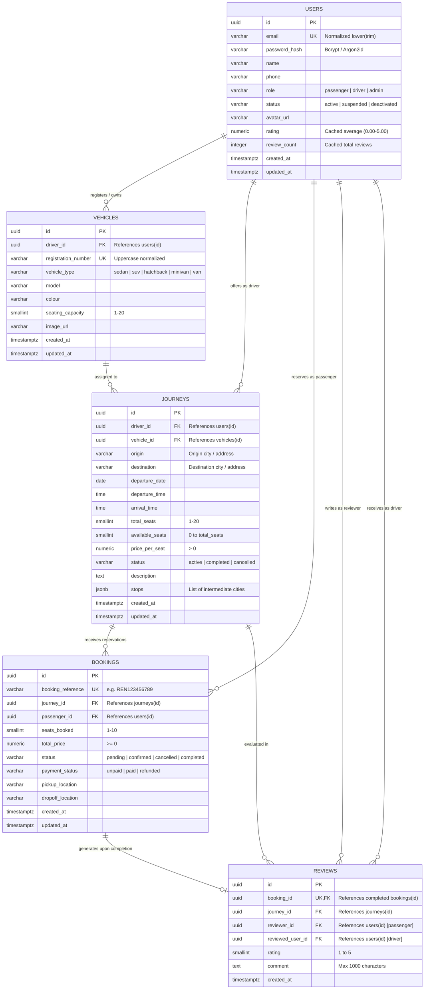
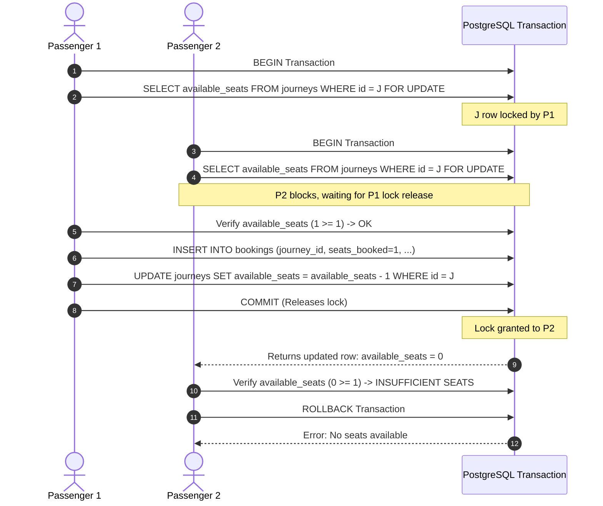

# RentASeat — Database Schema & Architecture Design (Step 2)

> **Important Operational Status:**
> The schema files and migration scripts documented here have been **designed and placed in version control** under `backend/migrations/`.
> **No schema changes have been executed against or applied to the live Amazon RDS database.**
> The live RDS database remains in its Step 2A state until approved and explicitly migrated.

---

## 1. Schema Overview & Entity-Relationship Model

The RentASeat relational database is designed for **PostgreSQL 14+** (hosted on Amazon RDS in private VPC subnets) and interfaces with the Python 3.13 AWS Lambda backend via the pure-Python `pg8000` driver.



---

## 2. Table Specifications & Data Dictionary

### 2.1 Table: `schema_migrations`
Tracks applied database migrations to ensure idempotency and ordered execution.

| Column | Type | Constraints | Description |
| :--- | :--- | :--- | :--- |
| `version` | `VARCHAR(50)` | `PRIMARY KEY` | Sequential identifier (e.g. `'001'`). |
| `name` | `VARCHAR(255)` | `NOT NULL` | Migration name (e.g. `'initial_schema'`). |
| `applied_at` | `TIMESTAMPTZ` | `NOT NULL DEFAULT CURRENT_TIMESTAMP` | UTC timestamp when migration was applied. |

---

### 2.2 Table: `users`
Central user registry containing passengers, drivers, and administrators.

| Column | Type | Constraints | Description |
| :--- | :--- | :--- | :--- |
| `id` | `UUID` | `PRIMARY KEY DEFAULT gen_random_uuid()` | Universally unique non-enumerable identifier. |
| `email` | `VARCHAR(255)` | `NOT NULL UNIQUE`, `CHECK (email = lower(trim(email)))` | Lowercase normalized email. |
| `password_hash` | `VARCHAR(255)` | `NOT NULL` | Salted password hash (bcrypt/Argon2id). |
| `name` | `VARCHAR(100)` | `NOT NULL`, `CHECK (length(trim(name)) >= 2)` | Full name. |
| `phone` | `VARCHAR(30)` | `NULL` | Optional contact telephone number. |
| `role` | `VARCHAR(20)` | `NOT NULL DEFAULT 'passenger'`, `CHECK (role IN ('passenger', 'driver', 'admin'))` | User role matching frontend `UserRole`. |
| `status` | `VARCHAR(20)` | `NOT NULL DEFAULT 'active'`, `CHECK (status IN ('active', 'suspended', 'deactivated'))` | Account lifecycle state. |
| `avatar_url` | `VARCHAR(500)` | `NULL` | Profile picture URI. |
| `rating` | `NUMERIC(3, 2)` | `DEFAULT 5.00`, `CHECK (rating >= 0 AND rating <= 5.00)` | Cached rolling average driver rating. |
| `review_count` | `INTEGER` | `DEFAULT 0`, `CHECK (review_count >= 0)` | Cached count of received ratings. |
| `created_at` | `TIMESTAMPTZ` | `NOT NULL DEFAULT CURRENT_TIMESTAMP` | Account creation timestamp. |
| `updated_at` | `TIMESTAMPTZ` | `NOT NULL DEFAULT CURRENT_TIMESTAMP` | Maintained via `trg_users_update_timestamp`. |

**Indexes**:
- `uq_users_email` ON `users (email)` — Case-insensitive unique lookups.
- `idx_users_role` ON `users (role)` — Filter drivers vs passengers.
- `idx_users_status` ON `users (status)` — Filter active users.

---

### 2.3 Table: `vehicles`
Motor vehicles registered by drivers to service carpool journeys.

| Column | Type | Constraints | Description |
| :--- | :--- | :--- | :--- |
| `id` | `UUID` | `PRIMARY KEY DEFAULT gen_random_uuid()` | Unique vehicle identifier. |
| `driver_id` | `UUID` | `NOT NULL REFERENCES users(id) ON DELETE RESTRICT` | Owning driver. |
| `registration_number`| `VARCHAR(30)`| `NOT NULL UNIQUE`, `CHECK (registration_number = upper(trim(registration_number)))` | Uppercase registration plate. |
| `vehicle_type` | `VARCHAR(20)` | `NOT NULL`, `CHECK (vehicle_type IN ('sedan', 'suv', 'hatchback', 'minivan', 'van'))` | Matches frontend `VehicleType`. |
| `model` | `VARCHAR(100)` | `NOT NULL`, `CHECK (length(trim(model)) >= 2)` | Vehicle make and model. |
| `colour` | `VARCHAR(50)` | `NULL` | Vehicle exterior colour. |
| `seating_capacity` | `SMALLINT` | `NOT NULL`, `CHECK (seating_capacity >= 1 AND seating_capacity <= 20)` | Maximum passenger seat capacity. |
| `image_url` | `VARCHAR(500)` | `NULL` | Photo of vehicle. |
| `created_at` | `TIMESTAMPTZ` | `NOT NULL DEFAULT CURRENT_TIMESTAMP` | Registration timestamp. |
| `updated_at` | `TIMESTAMPTZ` | `NOT NULL DEFAULT CURRENT_TIMESTAMP` | Maintained via `trg_vehicles_update_timestamp`. |

**Indexes**:
- `uq_vehicles_registration` ON `vehicles (registration_number)` — Unique vehicle check.
- `idx_vehicles_driver_id` ON `vehicles (driver_id)` — Driver inventory query.

---

### 2.4 Table: `journeys`
Ride offerings published by drivers along specified routes and schedules.

| Column | Type | Constraints | Description |
| :--- | :--- | :--- | :--- |
| `id` | `UUID` | `PRIMARY KEY DEFAULT gen_random_uuid()` | Unique journey identifier. |
| `driver_id` | `UUID` | `NOT NULL REFERENCES users(id) ON DELETE RESTRICT` | Publishing driver. |
| `vehicle_id` | `UUID` | `NOT NULL REFERENCES vehicles(id) ON DELETE RESTRICT` | Assigned vehicle. |
| `origin` | `VARCHAR(200)` | `NOT NULL`, `CHECK (length(trim(origin)) >= 2)` | Departure city / terminal. |
| `destination` | `VARCHAR(200)` | `NOT NULL`, `CHECK (length(trim(destination)) >= 2)` | Arrival city / terminal. |
| `departure_date` | `DATE` | `NOT NULL` | Calendar date of departure. |
| `departure_time` | `TIME` | `NOT NULL` | Scheduled departure time. |
| `arrival_time` | `TIME` | `NULL` | Estimated arrival time. |
| `total_seats` | `SMALLINT` | `NOT NULL`, `CHECK (total_seats >= 1 AND total_seats <= 20)` | Seats originally offered. |
| `available_seats`| `SMALLINT` | `NOT NULL`, `CHECK (available_seats >= 0 AND available_seats <= total_seats)` | Seats currently unreserved. |
| `price_per_seat` | `NUMERIC(10,2)`| `NOT NULL`, `CHECK (price_per_seat > 0)` | Cost per passenger seat. |
| `status` | `VARCHAR(20)` | `NOT NULL DEFAULT 'active'`, `CHECK (status IN ('active', 'completed', 'cancelled'))` | Lifecycle state. |
| `description` | `TEXT` | `NULL` | Driver trip notes and rules. |
| `stops` | `JSONB` | `DEFAULT '[]'::jsonb` | Intermediate stop city list. |
| `created_at` | `TIMESTAMPTZ` | `NOT NULL DEFAULT CURRENT_TIMESTAMP` | Post timestamp. |
| `updated_at` | `TIMESTAMPTZ` | `NOT NULL DEFAULT CURRENT_TIMESTAMP` | Maintained via `trg_journeys_update_timestamp`. |

**Integrity Rule**:
- `CHECK (lower(trim(origin)) <> lower(trim(destination)))` — Departure and arrival points must differ.

**Indexes**:
- `idx_journeys_search` ON `journeys (lower(origin), lower(destination), departure_date, status)` — Optimizes the `/search` query.
- `idx_journeys_driver_id` ON `journeys (driver_id)` — Queries for driver dashboard.
- `idx_journeys_departure` ON `journeys (departure_date, departure_time)` — Schedule queries.

---

### 2.5 Table: `bookings`
Seat reservations placed by passengers.

| Column | Type | Constraints | Description |
| :--- | :--- | :--- | :--- |
| `id` | `UUID` | `PRIMARY KEY DEFAULT gen_random_uuid()` | Unique booking identifier. |
| `booking_reference`| `VARCHAR(20)`| `NOT NULL UNIQUE`, `CHECK (booking_reference = upper(trim(booking_reference)))` | Human-readable code (e.g. `REN123456789`). |
| `journey_id` | `UUID` | `NOT NULL REFERENCES journeys(id) ON DELETE RESTRICT` | Target journey. |
| `passenger_id` | `UUID` | `NOT NULL REFERENCES users(id) ON DELETE RESTRICT` | Reserving user. |
| `seats_booked` | `SMALLINT` | `NOT NULL`, `CHECK (seats_booked >= 1 AND seats_booked <= 10)` | Number of seats reserved. |
| `total_price` | `NUMERIC(10,2)`| `NOT NULL`, `CHECK (total_price >= 0)` | Calculated total cost. |
| `status` | `VARCHAR(20)` | `NOT NULL DEFAULT 'pending'`, `CHECK (status IN ('pending', 'confirmed', 'cancelled', 'completed'))` | Booking state. |
| `payment_status` | `VARCHAR(20)` | `NOT NULL DEFAULT 'unpaid'`, `CHECK (payment_status IN ('unpaid', 'paid', 'refunded'))` | Payment state tracking. |
| `pickup_location`| `VARCHAR(255)`| `NULL` | Passenger pickup point. |
| `dropoff_location`| `VARCHAR(255)`| `NULL` | Passenger dropoff point. |
| `created_at` | `TIMESTAMPTZ` | `NOT NULL DEFAULT CURRENT_TIMESTAMP` | Reservation creation time. |
| `updated_at` | `TIMESTAMPTZ` | `NOT NULL DEFAULT CURRENT_TIMESTAMP` | Maintained via `trg_bookings_update_timestamp`. |

**Anti-Duplicate Constraint**:
- `CREATE UNIQUE INDEX uq_bookings_active_passenger ON bookings (journey_id, passenger_id) WHERE status NOT IN ('cancelled');`
  - Prevents a passenger from having multiple simultaneous non-cancelled bookings for the same journey.
  - Allows re-booking if an earlier attempt was cancelled.

**Driver Self-Booking Prevention**:
- Enforced via `trg_bookings_prevent_self_booking` executing `check_booking_passenger_not_driver()`:
  `RAISE EXCEPTION` if `passenger_id == journey.driver_id`.

---

### 2.6 Table: `reviews`
Post-trip driver feedback and star rating submitted by verified passengers.

| Column | Type | Constraints | Description |
| :--- | :--- | :--- | :--- |
| `id` | `UUID` | `PRIMARY KEY DEFAULT gen_random_uuid()` | Unique review identifier. |
| `booking_id` | `UUID` | `NOT NULL UNIQUE REFERENCES bookings(id) ON DELETE RESTRICT` | Exactly one review allowed per booking. |
| `journey_id` | `UUID` | `NOT NULL REFERENCES journeys(id) ON DELETE RESTRICT` | Associated journey. |
| `reviewer_id` | `UUID` | `NOT NULL REFERENCES users(id) ON DELETE RESTRICT` | Review author (passenger). |
| `reviewed_user_id`| `UUID` | `NOT NULL REFERENCES users(id) ON DELETE RESTRICT` | Target of review (driver). |
| `rating` | `SMALLINT` | `NOT NULL`, `CHECK (rating >= 1 AND rating <= 5)` | 1-to-5 star rating. |
| `comment` | `TEXT` | `NULL`, `CHECK (comment IS NULL OR length(trim(comment)) <= 1000)` | Written feedback. |
| `created_at` | `TIMESTAMPTZ` | `NOT NULL DEFAULT CURRENT_TIMESTAMP` | Review submission timestamp. |

**Review Eligibility & Anti-Self-Review Constraints**:
- `CHECK (reviewer_id <> reviewed_user_id)` prevents reviewing oneself.
- Enforced via `trg_reviews_check_eligibility`:
  1. `bookings.status` MUST be `'completed'`.
  2. `reviewer_id` MUST match `bookings.passenger_id`.
  3. `reviewed_user_id` MUST match `journeys.driver_id`.
- Enforced via `trg_reviews_recalculate_rating`:
  - Automatically updates `users.rating` and `users.review_count` for the driver upon review insertion.

---

## 3. Concurrency Control & Overbooking Prevention Strategy

### 3.1 The Concurrency Challenge
In a multi-user environment, two passengers $P_1$ and $P_2$ may simultaneously request the last available seat on journey $J$.
- A simple column-level `CHECK (available_seats >= 0)` or subquery check evaluated at read time will **not** prevent race conditions under default Read Committed isolation:
  - Both transactions read `available_seats = 1`.
  - Both transactions insert a booking for 1 seat.
  - Both update `available_seats = 0`.
  - The journey becomes overbooked by 1 seat.

### 3.2 Required Enforcement Mechanism

Overbooking prevention requires a combination of **pessimistic row-level locking** and **database-level invariant checks**:



### 3.3 Implementation Rules in API Code:
1. **Always acquire a lock**: Use `SELECT ... FROM journeys WHERE id = %s FOR UPDATE;`.
2. **Atomic decrement with invariant**:
   ```sql
   UPDATE journeys
   SET available_seats = available_seats - %s,
       updated_at = CURRENT_TIMESTAMP
   WHERE id = %s AND available_seats >= %s;
   ```
3. **Database invariant**:
   `CONSTRAINT chk_journeys_available_seats CHECK (available_seats >= 0 AND available_seats <= total_seats)` guarantees that the database will physically reject any decrement below 0.
4. **Cancellations**:
   When a booking is cancelled:
   ```sql
   UPDATE journeys
   SET available_seats = available_seats + %s,
       updated_at = CURRENT_TIMESTAMP
   WHERE id = %s;
   ```

---

## 4. Migration Execution & Prerequisites

### 4.1 Prerequisites Before Running Migrations
1. **RDS Subnet Connectivity**: The migration runner must be executed from a host that can reach the RDS instance inside the VPC (e.g. AWS CloudShell, EC2 bastion, or via a temporary Lambda migration function).
2. **Environment Variables**:
   ```bash
   export DB_HOST="your-rds-endpoint.rds.amazonaws.com"
   export DB_PORT="5432"
   export DB_NAME="postgres"
   export DB_USERNAME="rentaseat_admin"
   export DB_PASSWORD="<rds-password>"
   ```
   *(Never store passwords in `.env` files or commit to version control).*

### 4.2 Migration Commands via `backend/migrate.py`

| Goal | Command | Safe Offline? |
| :--- | :--- | :--- |
| **Validate SQL files offline** | `python3 backend/migrate.py --check` | **Yes (no credentials or network)** |
| **Inspect pending SQL without running** | `python3 backend/migrate.py --dry-run` | **Yes** |
| **Check migration status against DB** | `python3 backend/migrate.py --status` | No (requires DB connection) |
| **Apply pending migrations** | `python3 backend/migrate.py --up` | No (requires DB connection) |

### 4.3 Rollback Plan
If migration `001_initial_schema.sql` needs to be rolled back in a development or test environment:
```bash
# Execute down migration via psql or migration runner:
psql -h $DB_HOST -U $DB_USERNAME -d $DB_NAME -f backend/migrations/001_initial_schema.down.sql
```
> [!CAUTION]
> The `.down.sql` script drops tables and must **never** be executed against production environments containing live user data.

---

## 5. Security & Data Minimization

1. **Passwords**: Stored exclusively as one-way salted cryptographic hashes (`password_hash VARCHAR(255)`). Plaintext passwords are never stored.
2. **Payment Data Minimization**: No credit card numbers, CVVs, bank account numbers, or Stripe/PayPal tokens are stored. The table contains only a high-level `payment_status ('unpaid', 'paid', 'refunded')`.
3. **Zero Hardcoded Credentials**: Neither `001_initial_schema.sql` nor `migrate.py` contain passwords or IAM access keys.
4. **Access Control**: Table modifications are restricted to application roles; external public access is prohibited by private VPC subnets.
